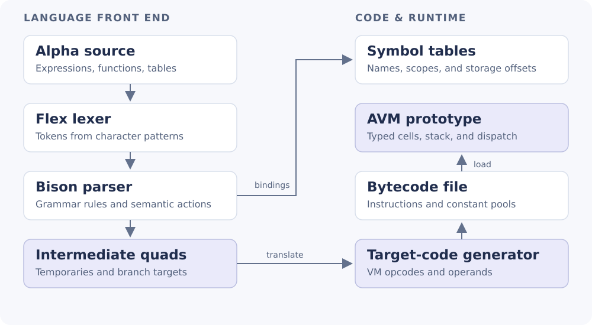

# Alpha Compiler & Virtual Machine

A compiler for the Alpha language that turns source programs into intermediate code and bytecode, with a companion stack-based virtual machine.



**C · Flex · Bison · GNU Make** · [Setup](docs/SETUP.md) · [Technical brief](docs/report.pdf) · [Overleaf sources](docs/report-overleaf.zip)

Developed jointly by **Dimitris Asimakopoulos**, **Alexandros Fourtounis**, and **Georgia Marina Tsanta** for HY340, University of Crete, 2023–2024.

## How it works

| Stage | Work implemented |
| --- | --- |
| [Lexical analysis](compiler/scanner.l) | Recognizes identifiers, keywords, literals, operators, and comments. |
| [Syntax and symbols](compiler/parser.y) | Parses expressions, control flow, functions, and tables, with symbol and scope tracking. |
| [Intermediate code](compiler/quads.c) | Emits three-address quads, temporary variables, and patched branch targets. |
| [Bytecode generation](compiler/quads.c) | Translates quads into VM instructions and writes constants, function metadata, and a binary program. |
| [Virtual machine](vm/avm.c) | Implements typed values, a runtime stack, instruction dispatch, calls, and table operations. The runtime remains experimental. |

The project connects language grammar, symbol-table design, code generation, binary serialization, and runtime memory management. The compiler exports readable quads and instruction listings alongside the bytecode, making the translation steps easy to inspect.

## Try it

On Linux with GCC, Flex, Bison, GNU Make 4.3+, and Python 3:

```bash
make
make demo
make check
```

The demo compiles a short arithmetic program and a `print` call. It displays the generated quads and saves the instruction listing, constant tables, and bytecode in a fresh directory under `build/`. It demonstrates compilation, rather than executing the experimental VM.

The source retains known course-project limitations in control-flow handling and VM execution. See the [technical brief](docs/report.pdf) for the precise verification scope and remaining issues.

[MIT license](LICENSE), preserved from the supplied project.
